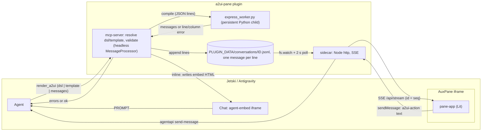
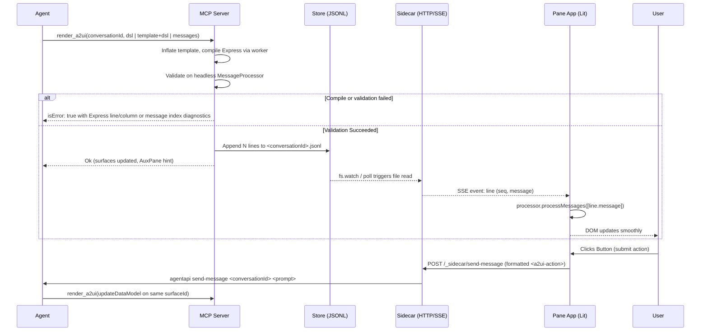

# a2ui-pane: Architecture & Design

## 1. Overview

`a2ui-pane` is a plugin for Jetski and Antigravity. It lets the agent display A2UI surfaces to the user and receive the user's actions back as chat turns.

Surfaces appear in two contexts:

- **The AuxPane:** A live UI plugin page displayed in the auxiliary pane beside the conversation. Surfaces update incrementally as the agent sends layout commands, and user clicks/submits route back to the agent without requiring extra user clicks.
- **Inline in Chat:** Self-contained `<agent-embed>` HTML cards displayed directly in conversation history for snapshot results and single-step forms.

Both contexts use the standard Lit renderer (`@a2ui/lit`) and state engine (`@a2ui/web_core`). The agent interacts with A2UI exclusively via a validating stdio MCP server (`render_a2ui`), which validates payloads before committing them and returns structured error diagnostics so the model can correct mistakes.

Authoring is A2UI Express by default. `render_a2ui` accepts `dsl` (Express source) or `template` plus `dsl` (a named, data-bound template from `plugin/skills/genui/templates` or `${PLUGIN_DATA}/templates`, inflated by concatenation so caller data overrides template defaults). The MCP server compiles Express with the upstream Python compiler running in one persistent child process (`python/express_worker.py`, JSON lines over stdio), paying the SDK import cost once per server lifetime. Raw `messages` remain supported. The `genui` skill shipped in `plugin/skills/genui` tells the agent which display channel fits (chat Markdown, artifact, inline card, pane, HTML widget, or the host's interactive question tool / chat prompt) and how to call the tools.

The codebase is structured as a standalone TypeScript monorepo under `packages/*`.

### 1.1 Goals

- Display A2UI surfaces in Jetski Web, Jetski desktop, and Antigravity.
- Support full live A2UI semantics in the AuxPane: multiple concurrent surfaces, `createSurface`, `updateComponents`, `updateDataModel`, `deleteSurface`, two-way data binding, and local function calls.
- Dispatch user interactions back to the conversation as new agent turns without extra confirmation clicks.
- Validate every layout payload against the catalog schema before committing to disk or forwarding to renderers.
- Support line-by-line progressive updates across sequential tool calls.
- Align with the host's light and dark theme tokens.
- Install cleanly from source into `~/.gemini/config/plugins/` without google3 or BinFS dependencies.

### 1.2 Non-goals

- Modifying host source code in Jetski or Antigravity.
- Authoring tools (Monaco editor, raw JSON viewer, CL creation).
- Protocol v0.8 or v1.0 rendering; the renderer targets v0.9 and v0.9.1. The Express worker already compiles to v1.0 behind `A2UI_PANE_PROTOCOL_VERSION`, so the flip is a renderer change (a Lit v1.0 basic catalog) plus switching the validators to the v1.0 `MessageProcessor`.
- Mid-call token-by-token streaming (Phase 0 verified `agentapi stream-conversation` is unsupported by the host daemon).

---

## 2. Architecture & Data Flow



### 2.1 AuxPane Lifecycle & Action Flow



---

## 3. Package Layout

The repository is organized as Yarn workspaces under `packages/*`:

| Package               | Purpose                                                                                                             | Dependencies                                              |
| :-------------------- | :------------------------------------------------------------------------------------------------------------------ | :-------------------------------------------------------- |
| `packages/protocol`   | TypeScript types for store lines, SSE stream events, and action formatting.                                         | None                                                      |
| `packages/theme`      | CSS stylesheet and utilities mapping host tokens (`--background`, `--card`, `--primary`, `--border`) to `--a2ui-*`. | None                                                      |
| `packages/renderer`   | Lit multi-surface container (`<a2ui-pane-view>`) wrapping `@a2ui/lit` and `@a2ui/web_core`.                         | `protocol`, `theme`, `@a2ui/lit`, `@a2ui/web_core`        |
| `packages/pane-app`   | Standalone Vite SPA loaded in the AuxPane iframe; consumes SSE stream.                                              | `renderer`, `protocol`                                    |
| `packages/embed`      | Self-contained IIFE bundle for inline `<agent-embed>` cards.                                                        | `renderer`, `protocol`                                    |
| `packages/sidecar`    | Standalone Node HTTP server serving the pane app, SSE updates, and action dispatching.                              | `protocol`                                                |
| `packages/mcp-server` | Stdio MCP server bundling validation, store writing, and prompt generation.                                         | `protocol`, `@a2ui/web_core`, `@modelcontextprotocol/sdk` |
| `plugin/`             | Output directory symlinked into `~/.gemini/config/plugins/a2ui-pane`.                                               | Build outputs + manifests                                 |
| `catalogs/`           | Bundled A2UI component catalog schemas.                                                                             | None                                                      |

---

## 4. Key Subsystems

### 4.1 Message Store (`${PLUGIN_DATA}/conversations/<conversationId>.jsonl`)

- **Structure:** Exactly one A2UI v0.9 server-to-client message per newline-terminated JSON line.
- **Envelope:**
  ```json
  {"seq": 1, "callId": "c_123", "ts": "2026-09-30T20:00:00Z", "message": { ... }}
  ```
- **Atomicity:** Written using `fs.appendFile` with `O_APPEND`.
- **Retention:** Files unaccessed for >30 days are purged on sidecar startup.

### 4.2 Sidecar & SSE Transport

- Runs a dedicated Node HTTP server on `127.0.0.1:$ANTIGRAVITY_SIDECAR_WEB_PORT`.
- SSE route `GET /api/stream?conversationId=...&token=...`:
  - `Content-Type: text/event-stream`, `Cache-Control: no-cache, no-transform`, `X-Accel-Buffering: no`.
  - Replays existing stored lines, then streams newly written lines.
  - Event `id` matches `seq`, enabling automatic reconnection without line loss via standard `Last-Event-ID`.
  - Dispatches `reset` event if the underlying store file is truncated or rotated.
- Serves `/preload.js` (SDK script or fallback shim), static pane SPA assets, and `POST /_sidecar/send-message`.

### 4.3 Action Round-Trip

When a user triggers an action (e.g. click), the Lit component emits an `A2uiClientAction`.
The pane formats the action into chat text via `formatActionText`:

```text
[A2UI] Triggered "Book Table" (book) on surface booking-form.
<a2ui-action>{"version":"v0.9","action":{"name":"book","surfaceId":"booking-form","sourceComponentId":"btn_submit","context":{"partySize":4}},"dataModel":{"partySize":4}}</a2ui-action>
```

The pane calls `window.sidecar.agent.sendMessage`, which POSTs to `/_sidecar/send-message` and triggers `agentapi send-message`.

### 4.4 Inline Embeds (`<agent-embed>`)

For snapshot results, the MCP server writes self-contained HTML files into `${PLUGIN_DATA}/embeds/<convId>/<surfaceId>.html` bundling:

- Inlined ~260 KB minified Lit IIFE bundle.
- JSON payload in `<script id="a2ui-messages" type="application/json">`.
- Theme tokens mapped from host document.
- Resizing via `postMessage({type: 'RESIZE'})`.
- Actions forwarded via `postMessage({type: 'PROMPT'})`.
