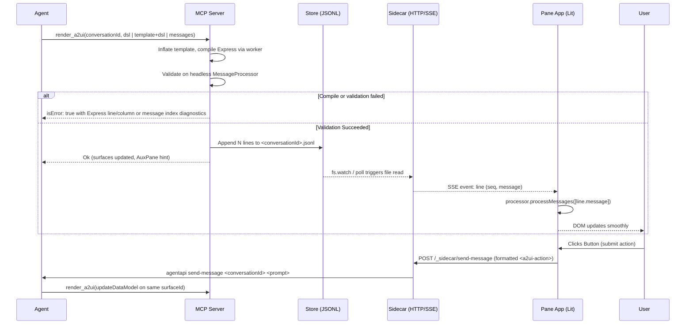

# a2ui-pane: Architecture & Design

## 1. Overview

`a2ui-pane` is a plugin for Antigravity and compatible agent hosts. It lets the agent display A2UI surfaces to the user and receive user actions back as chat turns.

Surfaces appear in two contexts:

- The AuxPane renders a live UI plugin page beside the conversation. Surfaces update incrementally as the agent sends layout commands, and user clicks route back to the agent automatically.
- Inline chat cards render self-contained `<agent-embed>` HTML snapshots directly in the conversation history for single-step forms and compact results.

Both contexts use the standard Lit renderer (`@a2ui/lit`) and state engine (`@a2ui/web_core`). The agent calls a validating stdio MCP server (`render_a2ui`), which checks payloads before saving them and returns structured error diagnostics for self-correction.

Authoring uses A2UI Express by default. `render_a2ui` accepts `dsl` (Express source) or `template` plus `dsl` (a named template from `plugin/skills/genui/templates` or `${PLUGIN_DATA}/templates`). When inflating a template, data assignments from the caller override the defaults in the template.

The MCP server compiles Express with the upstream Python compiler in one persistent child process (`python/express_worker.py`). This process communicates via JSON lines over stdio and pays the SDK import cost once. Raw `messages` remain supported. The `genui` skill in `plugin/skills/genui` guides channel selection and tool calls.

The codebase is structured as a standalone TypeScript monorepo under `packages/*`.

### 1.1 Goals

- Display A2UI surfaces in Antigravity and compatible web or desktop agent hosts.
- Support live A2UI semantics in the AuxPane: multiple concurrent surfaces, `createSurface`, `updateComponents`, `updateDataModel`, `deleteSurface`, two-way data binding, and local function calls.
- Dispatch user interactions back to the conversation as new agent turns without extra confirmation clicks.
- Check every layout payload against the catalog schema before writing to disk or forwarding to renderers.
- Support line-by-line progressive updates across sequential tool calls.
- Align with the host's light and dark theme tokens.
- Install cleanly from source or release archives into `~/.gemini/config/plugins/`.

### 1.2 Non-goals

- Modifying host source code.
- Authoring tools (Monaco editor, raw JSON viewer, or patch generation).
- Protocol v0.8 or v1.0 rendering; the renderer targets v0.9 and v0.9.1.
- Mid-call token-by-token streaming (`agentapi stream-conversation` is not supported by the host daemon).

---

## 2. Architecture & Data Flow


### 2.1 AuxPane Lifecycle & Action Flow



---

## 3. Package Layout

The repository is organized as Yarn workspaces under `packages/*`:

| Package               | Purpose                                                                                                             | Dependencies                                              |
| :-------------------- | :------------------------------------------------------------------------------------------------------------------ | :-------------------------------------------------------- |
| `packages/protocol`   | TypeScript types for store lines, SSE stream events, and action formatting.                                         | None                                                      |
| `packages/theme`      | CSS stylesheet and utilities mapping host tokens (`--background`, `--card`, `--primary`, `--border`) to `--a2ui-*`. | None                                                      |
| `packages/renderer`   | Lit multi-surface container (`<a2ui-pane-view>`) wrapping `@a2ui/lit` and `@a2ui/web_core`.                         | `protocol`, `theme`, `@a2ui/lit`, `@a2ui/web_core`        |
| `packages/pane-app`   | Standalone Vite SPA loaded in the AuxPane iframe; consumes SSE stream.                                              | `renderer`, `protocol`                                    |
| `packages/embed`      | Self-contained IIFE bundle for inline `<agent-embed>` cards.                                                        | `renderer`, `protocol`                                    |
| `packages/sidecar`    | Standalone Node HTTP server serving the pane app, SSE updates, and action dispatching.                              | `protocol`                                                |
| `packages/mcp-server` | Stdio MCP server bundling validation, store writing, and prompt generation.                                         | `protocol`, `@a2ui/web_core`, `@modelcontextprotocol/sdk` |
| `plugin/`             | Output directory symlinked into `~/.gemini/config/plugins/a2ui-pane`.                                               | Build outputs + manifests                                 |
| `catalogs/`           | Bundled A2UI component catalog schemas.                                                                             | None                                                      |

---

## 4. Key Subsystems

### 4.1 Message Store (`${PLUGIN_DATA}/conversations/<conversationId>.jsonl`)

- Structure: One A2UI v0.9 server-to-client message per newline-terminated JSON line.
- Envelope:
  ```json
  {"seq": 1, "callId": "c_123", "ts": "2026-09-30T20:00:00Z", "message": { ... }}
  ```
- Atomicity: Written using `fs.appendFile` with `O_APPEND`.
- Retention: Files unaccessed for over 30 days are purged on sidecar startup.

### 4.2 Sidecar & SSE Transport

- Runs a dedicated Node HTTP server on `127.0.0.1:$ANTIGRAVITY_SIDECAR_WEB_PORT`.
- SSE route `GET /api/stream?conversationId=...&token=...`:
  - `Content-Type: text/event-stream`, `Cache-Control: no-cache, no-transform`, `X-Accel-Buffering: no`.
  - Replays existing stored lines, then streams newly written lines.
  - Event `id` matches `seq`, enabling automatic reconnection without line loss via standard `Last-Event-ID`.
  - Dispatches `reset` event if the underlying store file is truncated or rotated.
- Serves `/preload.js` (SDK script or fallback shim), static pane SPA assets, and `POST /_sidecar/send-message`.

### 4.3 Action Round-Trip

When a user triggers an action (such as a click), the Lit component emits an `A2uiClientAction`.
The pane formats the action into chat text via `formatActionText`:

```text
[A2UI] Triggered "Book Table" (book) on surface booking-form.
<a2ui-action>{"version":"v0.9","action":{"name":"book","surfaceId":"booking-form","sourceComponentId":"btn_submit","context":{"partySize":4}},"dataModel":{"partySize":4}}</a2ui-action>
```

The pane calls `window.sidecar.agent.sendMessage`, which POSTs to `/_sidecar/send-message` and triggers `agentapi send-message`.

### 4.4 Inline Embeds (`<agent-embed>`)

For snapshot results, the MCP server writes self-contained HTML files into `${PLUGIN_DATA}/embeds/<convId>/<surfaceId>.html` bundling:

- Inlined ~260 KB minified Lit IIFE bundle (~70 KB gzipped).
- JSON payload in `<script id="a2ui-messages" type="application/json">`.
- Theme tokens mapped from host document.
- Resizing via `postMessage({type: 'RESIZE'})`.
- Actions forwarded via `postMessage({type: 'PROMPT'})` or the sidecar HTTP side-channel.

### 4.5 A2UI Express Worker & Protocol v1.0 Upgrade Path

Importing `a2ui.inference_formats.express` takes ~3.7 s warm with a direct Python interpreter and ~5.3 s via `uv run`. Individual compiles finish in milliseconds, so the MCP server keeps one persistent worker process alive (`python/express_worker.py`) and `install.sh` resolves the interpreter path into `mcp_config.json`.

Template inflation reduces agent token output by 2x to 4x compared to raw JSON. For example, `triage_matrix` shrinks from 4,260 B to 1,486 B, and `consequence_cards` shrinks from 3,080 B to 724 B.

To switch the default protocol target from `v0.9` to `v1.0`:

1. Upgrade `@a2ui/lit` to a release that exports a `v1_0` basic catalog (`@a2ui/web_core` already includes `v1_0`).
2. Switch `ConversationState` and the inline validator in `tools/render.ts` to the `v1_0` `MessageProcessor` when `A2UI_PANE_PROTOCOL_VERSION=v1.0`, and select the matching renderer in `pane-app` and `embed`.
3. Regenerate the template golden fixtures with `A2UI_PANE_PROTOCOL_VERSION=v1.0 UPDATE_GOLDENS=1`.
4. Align the catalog identifier in `CatalogRegistry` with the `v1.0` `catalogId` emitted by the compiler.

### 4.6 Link routing

Markdown links inside `Text` are clickable in both hosts. There is no Link component; the renderer keeps the anchors that `@a2ui/markdown-it` produces and the host decides what a click does.

Rendering (`packages/renderer/src/markdown-renderer.ts`): two filters normally drop non-`http` links. markdown-it's `validateLink` rejects `file:` (alongside `javascript:`, `vbscript:`, and `data:`), and DOMPurify strips `href` values with unknown schemes such as `conversation:`. Neither is configurable through `@a2ui/markdown-it`, so `renderRichMarkdown` runs a protect-and-restore pass next to its existing code-span protection:

1. While fenced blocks and code spans are still masked, `protectNonHttpLinks` rewrites `[label](scheme:rest)` for schemes other than `http`, `https`, and `mailto` to `[label](a2uilink:n)` and remembers the original. `javascript:`, `vbscript:`, and `data:` links collapse to their label text so a dangerous link degrades to plain text instead of exposing its syntax.
2. After sanitization, `restoreNonHttpLinks` replaces `href="a2uilink:n"` with `data-a2ui-href="<original>"`. These anchors carry no `href`, so the browser never sees a navigable unknown scheme. `http(s)` anchors keep their `href` and gain `rel="noopener noreferrer"`; they get no `target`, because the router owns navigation.

Dispatch (`A2uiPaneView`): surfaces are open shadow roots and `Text` has no shadow root, so a delegated `click` listener on the view sees anchors through `composedPath()`. On a primary, unmodified click whose path contains an anchor with `href` or `data-a2ui-href`, and no `a2ui-basic-button`, the view calls `preventDefault()` and dispatches `a2ui-link-click` with `{ href, label, scheme }` (`bubbles`, `composed`). Modified clicks (meta, ctrl, shift, middle button) keep the browser default. Links inside a `Button` label are ignored because the button handler has already fired on the inner element.

Routing (`packages/renderer/src/link-router.ts`, used by both hosts): `openLink(detail, { open, copy, toast })` opens `http(s)` links with `open(href, "_blank", "noopener,noreferrer")`. When `open` returns `null`, and for every other scheme, it copies the href and shows `Copied <href>`. The pane app uses `window.open`, `navigator.clipboard.writeText`, and `showToast(message, false)`. The inline embed runs in a sandboxed `srcdoc` iframe (`allow-scripts allow-forms allow-popups`, opaque origin) where popups may be blocked and `navigator.clipboard` may throw, so its copy path falls back to `document.execCommand('copy')` on a hidden textarea and reports in a `role="status"` line under the surface; when both fail the status shows the href itself so the user can select it.

Note on pane updates: The host hoists the AuxPane iframe, so it survives closing the pane tab and keeps running the JavaScript bundle it loaded even after `package.sh` replaces the files the sidecar serves. To pick up a new build without user action, `/api/config` reports a `buildId` (the `index.html` mtime in milliseconds, from the same `stat` the static cache uses, so it changes without a sidecar restart). `StreamClient` fetches the config on every SSE (re)connect, remembers the first `buildId`, and when a later value differs it shows a "Pane updated to a new build" toast and calls `location.reload()`. A guard in `sessionStorage` allows at most one reload per 30 seconds so a flapping `buildId` cannot loop. Manual fallback: the host's Reload Frame action on the pane, or closing and reopening the side pane.

### 4.7 Status Catalog Components: Table and Stepper

The status catalog (`catalogs/v1_0/status/catalog.json`) provides domain-specific status primitives:

- `Table` (`packages/renderer/src/a2ui-table.ts`): Tabular layout for grids with 3 or more columns or typed cells. Defines columns statically with `key`, `label`, optional `kind` (`text`, `number`, `badge`, `progress`, `link`, `check`, `icon`), optional `align`, and optional `width`. Binds rows dynamically via `rows`. Cells render inline badge styles and progress tracks directly rather than nesting custom elements, preserving controller bindings. Supports optional caption, sortable column headers with stable sorting, dense padding, row selection tracking via `selected`, and a row click `action`.
- `Stepper` (`packages/renderer/src/a2ui-stepper.ts`): Visual indicator for ordered lifecycle milestones. Takes a `steps` list of `{label, detail}`, a 0-based `current` step index, an optional `tone` override for the current step, and an optional `orientation` (`horizontal` or `vertical`). Steps before `current` render with `success` tone. The `current` step renders with an `active` pulse animation or the specified `tone`. Subsequent steps render neutral.
